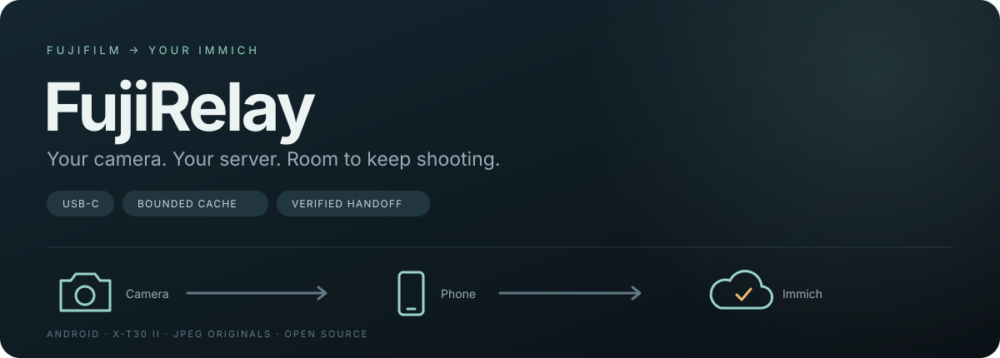
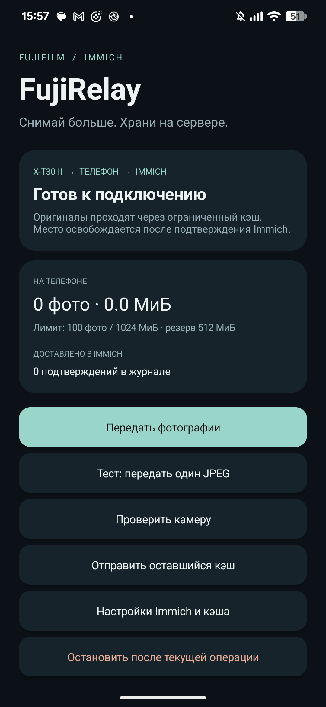
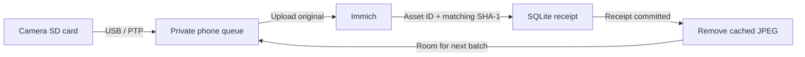

<p align="center"></p>

<p align="center">
  <strong>A small Android bridge from your Fujifilm camera to your own Immich server.</strong><br>
  USB transfer. Original JPEGs. A phone-sized queue, not a card-sized import.
</p>

<p align="center"><a href="#get-started">Get started</a> · <a href="#how-the-cache-works">How it works</a> · <a href="#build">Build</a> · <a href="todo.md">Roadmap</a> · <a href="docs/RU.md">По-русски</a></p>

## Why FujiRelay?

A day of shooting can leave tens of gigabytes on an SD card. Your phone should
not need that much free storage just to get the photos into Immich.

FujiRelay reads JPEGs over USB, stages a bounded batch, uploads directly to
Immich, checks the server's checksum, and frees each confirmed local copy.
Its SQLite journal remembers delivery after the cache is gone.

| | Default behavior |
|---|---|
| Phone cache | At most **100 photos** and **1 GiB**, whichever fills first |
| Free-space reserve | **512 MiB** before admitting the next photo |
| Local cleanup | After server confirmation **and** a committed SQLite receipt |
| Resume | Existing cache goes first; confirmed camera files are skipped |
| Originals | JPEG bytes are copied without resizing or recompression |
| Camera | Fujifilm **X-T30 II**, observed USB ID `04cb:02f3` |
| Android | Android 10+; tested on Pixel 7 Pro |
| Runtime libraries | Android APIs and Java standard library only |

**Status: early alpha.** USB import has been exercised on real hardware. The
Immich handoff is covered by device-side tests against a local API fixture;
validation against a real Immich instance is still pending. Do a one-photo
test after configuring your server.

## Get started

1. Install an APK built from this repository.
2. On the camera, choose **USB CARD READER** and set **USB POWER SUPPLY** to **OFF**.
3. Connect a data-capable USB-C cable. Close other camera import apps and grant USB access.
4. Open **Настройки Immich и кэша**. Enter your Immich URL and an API key with
   `asset.upload`, `asset.read`, and `user.read` permissions. The app adds `/api`
   when the URL does not already end with it.
5. Keep the default cache limits or choose smaller ones. Use HTTPS; HTTP requires
   an explicit opt-in for a trusted local network.
6. Tap **Тест: передать один JPEG**, check the photo in Immich, then start the full relay.

The UI is currently in Russian. Notification permission lets Android show the
active transfer. Existing cached files can be sent without reconnecting the camera.

<details>
<summary><strong>See the Android interface</strong></summary>
<p align="center"></p>
</details>

## How the cache works



The relay fills a batch up to the photo/byte limits, then sends and removes
its files one by one. USB and network operations are currently sequential.
If Immich is slower than the camera, the app waits instead of downloading beyond
the budget. If the network or server fails, the run pauses with the remaining
cache intact. Tap **Отправить оставшийся кэш** to retry it, or start the relay again.

For each file, the app:

1. Records its source identity and writes a temporary `.part` file in app-private storage.
2. Checks the expected byte count, flushes the file, computes SHA-1, and records the cached copy.
3. Checks for an existing Immich asset by checksum; otherwise uploads the original.
4. Fetches the asset by ID and requires the same checksum and owner, with
   `isTrashed=false` and `isOffline=false`.
5. Commits a receipt scoped to the **server URL + Immich user ID**.
6. Deletes that file from the private queue, making room for the next batch.

A lost upload response is safe to retry: the next attempt checks for a duplicate
and verifies it. A crash after receipt creation leaves cleanup for the next run.
Incomplete `.part` files are removed on recovery. A missing or ambiguous
server response never authorizes removal of an unconfirmed cached JPEG.

Confirmation means **Immich acknowledged an available original with a matching
checksum**. It does not wait for thumbnails, face detection, or indexing, and it
does not re-download the original as an independent integrity audit.

The camera is used only for enumeration and reads. Cache cleanup is limited to
the app's private queue. Photos previously imported into the phone gallery are
outside that queue. The official Immich mobile app is not required for the relay.

## Storage and recovery

| Data | Location / lifetime |
|---|---|
| Staged JPEGs | App-private `files/relay/`; survive app restarts and APK updates |
| Source records and receipts | SQLite `relay.db`; remain after local JPEG cleanup |
| API key | AES-GCM encrypted using an Android Keystore key |
| Diagnostics | `files/last-import.log`; replaced at the start of each run |

There is no LRU eviction of unconfirmed photos. A file larger than the byte
budget pauses the relay; increase the limit to admit it. Lowering the limit below
the existing cache size does not erase pending photos: existing work drains first.
The budget covers staged image bytes, not the small database and logs.

Receipt history is local to this installation. Clearing app data or uninstalling
removes it along with unsent cache files. A receipt records past delivery; deleting
an asset from Immich later does not automatically re-import it. Changing the
server URL or account starts a separate delivery history.

HTTPS certificates are checked by Android. Redirects are not followed with an
API key attached. HTTP opt-in sends credentials and photos without transport
encryption. Settings containing the key are excluded from Android backups.

## Build

Requires JDK 17+ (tested with 21), Android SDK platform 35, and an authorized ADB
device for installation. The Gradle wrapper downloads Gradle 8.9.

```sh
export JAVA_HOME=/path/to/jdk-21
export ANDROID_HOME=/path/to/android-sdk
./gradlew :app:assembleDebug :app:lintDebug
adb install -r app/build/outputs/apk/debug/app-debug.apk
```

Package: `dev.malordin.fuji.usb`. Version: `0.2.0`. A debug APK updates the original
USB importer when signed with the same local debug key. No signing secrets or
Immich credentials belong in the repository.

## Verification

```sh
# Installed debug APK, one authorized phone, no active transfer:
python3 tests/protocol_check.py

# Optional real camera catalog check; grant USB access in the app first:
python3 tests/camera_check.py
```

The protocol checks run real SQLite, filesystem, Android Keystore, and HTTP code
on the phone against a Python fixture using synthetic bytes. They cover the
Immich 2.x/3.x upload formats, checksum mismatch, failed or ambiguous responses,
lost acknowledgements, database write failure, restart recovery, and a full
100-file cache. They do not read camera photos, production credentials, or the
production journal. The instrumentation runner is included only in debug builds.

See [test notes](docs/TESTING.md) for the scope and observed results.

## Scope

This release handles JPEGs from one tested camera model. RAW, video, background
network retries, concurrent USB/network transfer, and history export are tracked
in [todo.md](todo.md). Android controls foreground-service lifetime; pause and
restart preserve the queue, but automatic restart after reboot is not implemented.

## Credits and license

FujiRelay is an independent project, unaffiliated with Fujifilm or Immich.
The [Fudge](https://github.com/petabyt/fudge) and
[libfuji](https://github.com/petabyt/libfuji) projects helped establish the landscape;
this app uses Android's [MtpDevice](https://developer.android.com/reference/android/mtp/MtpDevice)
directly. The Immich client follows the official
[OpenAPI specification](https://github.com/immich-app/immich/blob/main/open-api/immich-openapi-specs.json).

Application source and artwork: [MIT](LICENSE).
The Gradle wrapper is distributed under its Apache 2.0 license.
